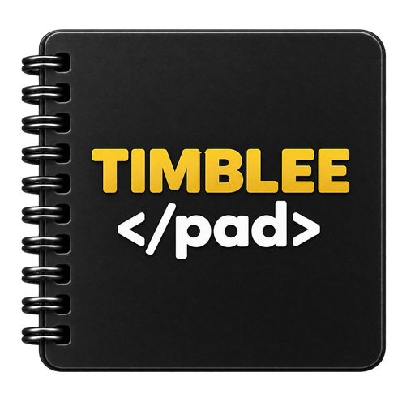

<p align="center">
  <a href="https://github.com/brunonlinespace/timblee-pad">
    
  </a>
</p>

# Timblee Pad

**Friendly. Fast. Focused.**

Timblee Pad is a lightweight standalone source editor for HTML, CSS and XML-family files. It edits ordinary source files directly and adds language-aware highlighting, indentation, templates, a reusable insertion Library, and focused browser preview without introducing a project database, embedded browser engine, language server, validator, or linter.

Current release: **0.2.3**

Repository: <https://github.com/brunonlinespace/timblee-pad>

## What Timblee Pad is

Timblee Pad is designed for people who want a focused desktop editor for web and markup source without the weight of a full IDE or browser-based development environment.

The source file is always authoritative. Timblee uses document profiles to select syntax highlighting, indentation, Library content, templates, closing-tag behavior, and Preview availability while preserving the document as ordinary text.

Supported filename extensions are:

- HTML: `.html`, `.htm`
- CSS: `.css`
- XML family: `.xml`, `.xsd`, `.xsl`, `.xslt`

Timblee deliberately does not treat SVG as a standalone document type. Inline SVG can still be authored inside HTML, but dedicated SVG/ICO editing is outside Timblee Pad's current scope.

## Highlights

- Focused **HTML, CSS and XML-family source editing**.
- Language-aware **syntax highlighting** with independent Dark / Light editor palettes.
- HTML/XML **tag matching**, conservative closing-tag completion, and markup-aware indentation.
- CSS brace indentation and language-appropriate comment toggling.
- **Line Numbers**, Word Wrap, Insert/Overwrite mode, Go To Line, and View Only.
- Four persistent **toolbar / Find layouts** with Inline and Split arrangements.
- Start-screen **Start a Document** workflow with document type, templates, and configurable New defaults.
- Main **Find** field plus Find Next/Previous, Replace, and match navigation.
- Language-aware **Library** with 114 HTML/HTM, 148 CSS, and 94 XML-family built-ins.
- Library **Favourites**, custom HTML tags, bounded import/export, and left/right/floating placement.
- Built-in and bounded custom **document templates** with optional initial-caret placement.
- **Preview in default browser** for saved HTML and XML through a loopback-only HTTP server.
- Safe Save / Save As, Duplicate, Rename, Delete, Open in External Editor, and Open Containing Folder workflows.
- Preservation of detected **encoding, BOM, and predominant line endings** when saving.
- External-change detection and guarded, atomic/no-clobber file replacement.
- Configurable **File Drag and Drop** behavior for the active window or a new window.
- Native/global application menu plus optional toolbar menu buttons through **Menu Only**.
- AppImage-only Dark / Light / System shell themes, independent from **Dark Editor**.
- **Keyboard Shortcuts** reference, bundled documentation, GitHub and issue links.
- No Node/npm, JavaScript runtime, language server, validator/linter engine, Qt WebEngine, PDF stack, or printing subsystem.

## Interface

### AppMenu and command row

Timblee Pad keeps its application command structure intentionally compact:

**File · Edit · View · Library · Help**

The same menus are available from the native application menu and from the toolbar menu buttons. **View → Menu Only** switches between the native menu-bar presentation and the toolbar menu-button presentation without changing the command model.

The toolbar also provides **Preview** when a document supports browser preview. Document type is intentionally not kept as a permanent toolbar shortcut; it remains available from **File → Document Type** for an active document.

### Layout and Find

Timblee Pad provides four persistent interface layouts:

- **Inline — Top**
- **Inline — Bottom**
- **Split — Toolbar Up / Search Down**
- **Split — Toolbar Down / Search Top**

In Inline layouts, Find shares the toolbar row. In Split layouts, Find belongs to the document column only. A left or right Library sidebar therefore spans the full workspace height instead of having the Find bar run across it.

The current Find query is retained when switching layouts. `Ctrl+F` focuses Find, `F3` and `Shift+F3` move through matches, `Ctrl+H` opens Replace, and `Esc` clears the current search.

### Start a Document

There is no splash screen.

When **Default New Document** is set to **Always Ask**, a file-less launch shows **Start a Document** in the normal editor workspace. The user can choose a document type and template, make that combination the default, create the document, or open an existing file.

The Start screen respects the same saved Inline/Split layout as an active document. Find remains visible in its configured position but disabled, and the Edit commands remain visible but disabled until a document becomes active.

`Ctrl+N` follows the saved New-document preference. **File → New Type…** always opens the chooser, while **File → Default New Document…** changes or resets the default.

## Editing

Timblee Pad edits ordinary source text directly.

HTML and XML use markup-aware editing behavior, including matching opening/closing tags, indentation, and conservative closing-tag completion. HTML applies HTML-specific case and void-element rules; XML matching remains case-sensitive.

CSS uses its own syntax highlighting, brace indentation, and `/* … */` comment behavior. Markup documents use `<!-- … -->` comments.

The editor also provides:

- Undo / Redo;
- Cut / Copy / Paste / Delete;
- Toggle Comment;
- Duplicate Line / Selection;
- Delete Line;
- Select All;
- Go To Line;
- Find / Replace;
- Word Wrap;
- Line Numbers;
- Insert / Overwrite mode;
- configurable display font.

**View Only** prevents document mutation while retaining non-mutating navigation and selection operations such as Copy, Select All, and Go To Line.

Timblee intentionally does **not** claim document validation or linting. There is no `Type OK`, format-mismatch, XML-well-formedness, or similar pseudo-validation status. Users remain free to use the validators, linters, browsers, or development tools appropriate to their own workflow.

## Library

The **Library** is Timblee Pad's reusable insertion surface and changes with the active document type.

Current built-in catalogues contain:

- **114 HTML/HTM entries**, covering the current non-obsolete HTML element set plus useful inline SVG/MathML roots;
- **148 CSS entries**, spanning selectors, layout, sizing, positioning, box model, typography, colour/media, transforms, animation, responsive/container queries, at-rules, variables, interaction, scrolling, tables, and practical patterns;
- **94 XML-family entries**, covering generic XML, document/DTD/entity helpers, XML Schema (XSD), and XSLT constructs.

**View → Library** selects:

- **Left Sidebar**;
- **Right Sidebar**;
- **Floating Only**.

The embedded sidebar uses a compact catalogue drop-down and a small close button. Closing a configured sidebar hides it only temporarily and does not rewrite the saved left/right placement. The floating Library retains the tabbed catalogue presentation and the custom/import/export controls.

`Ctrl+L` follows the saved placement: it shows or hides a configured left/right sidebar, or opens/closes the floating Library when **Floating Only** is selected.

Favourites are document-type aware. **Favourites** appears only when the active document type actually has one or more favourites; otherwise the Library defaults to **All**. Removing the last favourite while Favourites is selected returns the Library cleanly to All.

HTML additionally supports bounded **custom tags** plus `.timbleetags` import/export through the Library menu and floating Library.

The ten direct HTML insertion shortcuts are:

| Element | Shortcut |
| --- | --- |
| `<html>` | `Ctrl+1` |
| `<head>` | `Ctrl+2` |
| `<title>` | `Ctrl+3` |
| `<body>` | `Ctrl+4` |
| `<main>` | `Ctrl+5` |
| `<section>` | `Ctrl+6` |
| `<p>` | `Ctrl+7` |
| `<a>` | `Ctrl+8` |
| `` | `Ctrl+9` |
| `<h1>` | `Ctrl+0` |

## Templates

Built-in templates are immutable:

- HTML: **Blank HTML**, **HTML5 Document**
- CSS: **Blank Stylesheet**, **Basic Stylesheet**
- XML: **Blank XML**, **Basic XML Document**

**Library → Templates → Manage Templates…** manages bounded custom templates. A custom template may contain one `[[cursor]]` marker to define the initial caret position after insertion.

Templates remain source text; Timblee does not introduce a private document format.

## Preview

**Preview in default browser** (`F5`) is available for saved HTML and XML-family documents. CSS remains intentionally non-previewable by itself.

Preview starts a small HTTP server bound explicitly to `127.0.0.1`, serves the active document's containing directory, and opens the generated HTTP URL in the system's normal browser.

Timblee Pad does not embed Qt WebEngine and does not itself provide a JavaScript runtime. Browser behavior remains the responsibility of the user's chosen browser.

## File handling and external changes

Timblee Pad keeps source-file safety within the normal standalone editor workflow.

Normal opens are limited to supported regular source files up to **25 MiB**. Files that appear to contain binary control data are rejected rather than loaded as source text.

When opening source, Timblee recognises BOM-marked UTF-8, UTF-16, and UTF-32, honours practical HTML/CSS/XML encoding declarations where possible, and otherwise falls back to explicit user-selectable legacy/system encodings when UTF-8 decoding fails.

Saving preserves the active encoding, BOM, and predominant original newline style. If edited text cannot be represented in the current encoding, the save is cancelled rather than silently replacing characters.

The file opened or last written is tracked through a stable filesystem/content snapshot. If the disk copy changes externally before Save, Timblee offers explicit **Reload**, **Save As**, **Overwrite**, or **Cancel** choices instead of blindly replacing another program's changes.

Ordinary saves use a synchronized temporary file followed by guarded replacement. New-file installation and Rename avoid silently clobbering a destination that appears during the operation. Symbolic-link saves retain target/path identity checks so retargeting races are rejected.

The File menu also provides **Duplicate File**, **Rename**, **Delete File**, **Open in External Editor**, and **Open Containing Folder** workflows.

## File Drag and Drop

**View → File Drag and Drop** provides two persistent behaviors:

- **Opens on Active Window**; or
- **Opens on New Window**.

Dropped files still pass through Timblee Pad's normal supported-extension and file-safety checks.

## Appearance

The editor canvas and the AppImage shell are intentionally separate choices.

**View → Dark Editor** is enabled by default and switches the editor canvas, line-number gutter, selections, search highlighting, and HTML/CSS/XML syntax palette between matching dark and light schemes.

The Linux AppImage additionally includes lightweight bundled shell themes. **View → Dark Mode** is available in the packaged AppImage, while one-launch overrides support:

```bash
./Timblee-Pad-0.2.3-x86_64.AppImage --appimage-theme=dark
./Timblee-Pad-0.2.3-x86_64.AppImage --appimage-theme=light
./Timblee-Pad-0.2.3-x86_64.AppImage --appimage-theme=system
```

The source-portable form otherwise follows the host Qt appearance.

## Useful keyboard shortcuts

| Shortcut | Action |
| --- | --- |
| `Ctrl+N` | New |
| `Ctrl+Shift+N` | New Window |
| `Ctrl+O` | Open… |
| `Ctrl+S` | Save |
| `Ctrl+Shift+S` | Save As… |
| `F5` | Preview in default browser |
| `Ctrl+Shift+E` | Open in External Editor |
| `F2` | Rename… |
| `Ctrl+Shift+D` | Duplicate File |
| `Ctrl+Shift+O` | Open Containing Folder |
| `Ctrl+Z` | Undo |
| `Ctrl+Y` | Redo |
| `Ctrl+X` | Cut |
| `Ctrl+C` | Copy |
| `Ctrl+V` | Paste |
| `Delete` | Delete |
| `Ctrl+/` | Toggle Comment |
| `Ctrl+D` | Duplicate Line / Selection |
| `Ctrl+Shift+K` | Delete Line |
| `Ctrl+A` | Select All |
| `Ctrl+F` | Find |
| `F3` / `Shift+F3` | Next / Previous match |
| `Ctrl+H` | Replace… |
| `Ctrl+G` | Go To Line… |
| `Ctrl+L` | Show / hide Library according to saved placement |
| `F1` | Documentation |
| `Ctrl+Q` | Exit |

Delete File intentionally has **no keyboard shortcut**.

The **Help → Keyboard Shortcuts** dialog is the authoritative in-application reference for the complete current shortcut set, including the ten direct HTML Library insertions.

## Running from source

Timblee Pad uses the common source-portable layout:

```text
main.py
suite-pythoine-component.json
timblee_pad/
```

The current runtime requirement is Python 3.11+ with PyQt6 6.x (`PyQt6>=6.6,<7`).

From the extracted source root:

```bash
python3 -m venv .venv
source .venv/bin/activate
python -m pip install -r timblee_pad/requirements.txt
python3 main.py
```

Other useful launch forms:

```bash
python3 main.py --version
python3 main.py index.html
python3 main.py styles.css
python3 main.py data.xml
```

Multiple supported paths supplied on the command line open in independent Timblee Pad windows.

## Building the AppImage

The Fedora AppImage builder is included in the source tree:

```bash
bash timblee_pad/packaging/fedora/build-appimage.sh
```

The current builder is designed for native **x86_64** and **aarch64** Fedora hosts and is validated for **Fedora 43/44**. It is deliberately non-privileged: it does not install host packages or invoke privilege-elevation helpers.

The builder creates an isolated Python environment, runs Timblee Pad QA, freezes the application with PyInstaller, assembles and validates the AppDir, verifies the fixed application identity and metadata, exercises default/dark/light/system GUI and exact-version smoke tests, resolves appimagetool under the hardened packaging policy, and records release provenance.

Expected outputs beneath `timblee_pad/dist/` include:

```text
Timblee-Pad-0.2.3-<arch>.AppImage
Timblee-Pad-0.2.3-<arch>.AppImage.sha256
Timblee-Pad-0.2.3-<arch>.build-info.txt
Timblee-Pad-0.2.3-<arch>.build-python-lock.txt
```

Do not normally run the builder with `sudo` or as root.

A finished AppImage can additionally be exercised with:

```bash
bash timblee_pad/packaging/fedora/test-appimage.sh
```

## Validation

Run the authoritative source-release gate with:

```bash
bash timblee_pad/qa/run-qa.sh
```

The retained QA covers application identity, supported HTML/CSS/XML scope, the deliberate absence of SVG document routing and pseudo-validation, editor and Start-screen state, Library catalogues and favourites, templates, layout/sidebar behavior, file shortcuts, safe file workflows, localhost Preview, bundled assets, AppImage metadata/theme contracts, Suite Pythoine component metadata, and source-manifest integrity.

The Fedora AppImage builder adds final packaged-runtime GUI and theme smoke checks.

## Configuration

Timblee Pad stores per-user preferences outside source documents.

Linux:

```text
~/.config/brunonlinespace/timbleepad/timbleepad.json
```

Windows:

```text
%APPDATA%\brunonlinespace\TimbleePad\timbleepad.json
```

Preferences include interface layout, menu presentation, word wrap, line numbers, status-bar visibility, Library placement/favourites, New-document defaults, custom templates/tags, drag-and-drop behavior, editor palette/font, and the AppImage theme choice where applicable.

Source documents remain ordinary HTML, CSS, or XML-family files and are never embedded into the configuration.

## Scope

Timblee Pad is a **standalone HTML, CSS and XML-family source editor**.

It deliberately does not try to become a full IDE, graphical web designer, SVG/ICO graphics editor, project/workspace manager, browser engine, JavaScript runtime, package manager, language server, debugger, validator, or linter.

Its goal is to provide focused source editing, useful insertion/reference tools, careful file handling, and straightforward external browser preview while leaving build systems, validation, linting, scripting, and broader development workflows to the tools chosen by the user.

## License

Timblee Pad is licensed under the **GNU General Public License v3.0 or later**.

See `timblee_pad/LICENSE` for the complete license text.

## Links

- Timblee Pad: <https://github.com/brunonlinespace/timblee-pad>
- Issues: <https://github.com/brunonlinespace/timblee-pad/issues>
- GitHub profile: <https://github.com/brunonlinespace/>

Copyright © 2026 Bruno Machado.
